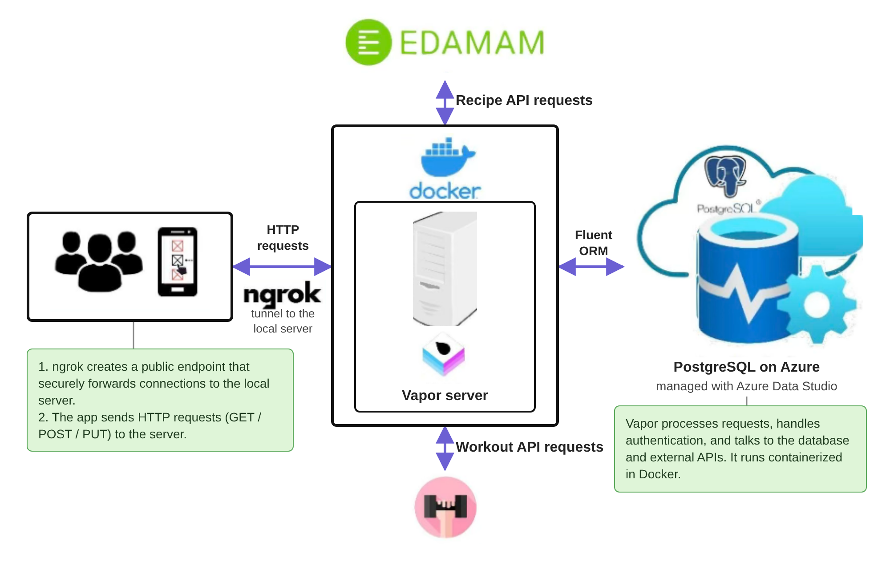

# Glowin: backend

The server behind **Glowin**, an iOS fitness app that turns a user's body measurements into personalized fitness goals, workout plans and recipes that fit their nutrition targets.

Built solo in Swift with **Vapor**, backed by **PostgreSQL** and containerized with **Docker**. The iOS app lives in [Glowin-frontend2](https://github.com/ayaanmonappa/Glowin-frontend2).



## At a glance

| | |
|---|---|
| Language | Swift (~1,900 lines across 26 files) |
| Framework | Vapor 4, Fluent ORM |
| Database | PostgreSQL, 4 tables evolved through 6 migrations |
| API | 21 REST endpoints across 7 route groups |
| Auth | Bcrypt-hashed passwords, bearer-token sessions |
| External APIs | Edamam (recipes), ExerciseDB via RapidAPI (exercises) |
| Infrastructure | Docker + docker-compose, ngrok tunnel for device testing |

## What it does

**Accounts and security.** Users sign up with a username and email (both checked for availability first). Passwords are hashed with Bcrypt, and logging in returns a token that every protected route requires.

**Body measurements.** Users log weight, height, chest, waist, bicep, thigh and calf measurements over time, which the app charts as progress.

**Personalized goals.** From the latest measurements and the user's profile, the server calculates:
- **BMR** (calories burned at rest) with the Harris-Benedict equation, adjusted for gender, weight, height and age
- **BMI**
- **TDEE** (daily calorie needs), using an activity multiplier from sedentary (×1.2) to super active (×1.9)

It combines these with the user's goal (gain muscle, lose fat, maintain) and body type (ectomorph, mesomorph, endomorph) to generate realistic target measurements with target dates.

**Workout plans.** Users pick how many days a week they train, and the server builds a training split matched to their goal: muscle gain, fat loss, maintenance or general fitness. Each exercise gets sets and reps, and full exercise details are pulled from ExerciseDB.

**Recipes that fit the plan.** The server works out each user's calorie range and protein, fat and carb targets, then searches Edamam for recipes inside those ranges, paging through results to build a full list.

## API

All routes except account creation, login and availability checks require a bearer token.

| Area | Method | Route | Purpose |
|---|---|---|---|
| Users | GET | `/users/check-username` | Is a username available? |
| | GET | `/users/check-email` | Is an email available? |
| | POST | `/users/create` | Sign up |
| | POST | `/users/login` | Log in, returns a token |
| | GET | `/users/:userId` | Public user details |
| | GET | `/users/profile` | Current user's profile |
| | GET | `/users/goal` | Current user's fitness goal |
| | POST | `/users/updateAge` | Update age |
| | POST | `/users/updateGoal` | Update fitness goal |
| | POST | `/users/updateBodyType` | Update body type |
| | POST | `/users/updateActivityLevel` | Update activity level |
| | POST | `/users/updateLastGoalGeneration` | Record when goals were last generated |
| Measurements | GET | `/measurements` | All of the user's measurements |
| | POST | `/measurements` | Log a new measurement |
| | PUT | `/measurements/:id` | Edit a measurement |
| Goals | POST | `/goals/generate` | Generate personalized goals |
| | GET | `/goals` | Get the user's goals |
| Workouts | POST | `/workouts/generate` | Generate a workout plan |
| Recipes | GET | `/recipes` | Recipes matched to the user's nutrition targets |
| | GET | `/external/recipes` | Direct recipe search |
| Database | GET | `/database/tables` | List tables (development) |

## Data model

| Table | Holds |
|---|---|
| `users` | username, email, hashed password, gender, age, goal, body type, activity level, last goal generation date |
| `measurements` | weight, height, bicep, calf, waist, thigh, chest and date, linked to a user |
| `generated_goals` | measurement type, target value, target date and generation date, linked to a user |
| `user_tokens` | login tokens, linked to a user |

## Project structure

```
Sources/App/
├── Controllers/   route handlers, goal and workout generators
├── Migrations/    database schema, built up in 6 steps
├── Models/        Fluent models for each table
└── Utilities/     app configuration, routes, Edamam service
docs/              architecture diagram
```

## Running it locally

**You'll need:** Xcode, Docker, Vapor (`brew install vapor`) and ngrok (`brew install ngrok`). Azure Data Studio is optional, for browsing the database.

1. **Set up your keys.** Copy `.env.example` to `.env` and add your own Edamam and RapidAPI keys. `.env` is git-ignored, so keys never get committed.
2. **Start the database:** `docker compose up db`
3. **Run the server:** open `Package.swift` in Xcode and press Run. It listens on port 8080.
4. **Expose it to your phone or simulator:** `ngrok http 8080`, then paste the forwarding URL into `baseURL` in the app's `Utilities/constants.swift`.
5. **Browse the data (optional):** connect Azure Data Studio to PostgreSQL using the values in `.env`.
